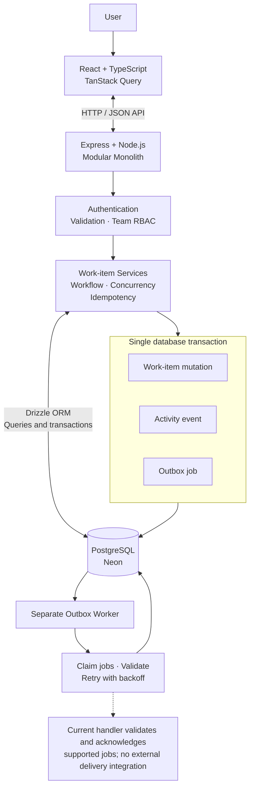

# Newtonite Operations Under Pressure

## 1. What the app does

Newtonite Operations is an internal work-management application for teams to create, assign, track, approve, and resolve operational work items. It provides role-based access control (Viewer, Member, Lead, Admin), a linear workflow (Open → In Progress → Awaiting Approval → Resolved → Closed), and append-only activity history recording who changed what and when. All mutations are transactional with optimistic concurrency and idempotency protection.



## 2. Prerequisites and exact run commands

### Prerequisites
- Node.js 22 LTS (verified via `engines` in package.json and CI)
- A Neon PostgreSQL database (connection string required)
- npm 10+ (bundled with Node.js 22)

### Required environment variables
Copy `backend/.env.example` to `backend/.env` and set:
- `DATABASE_URL` — Neon PostgreSQL connection string (required)
- `JWT_SECRET` — Strong random secret, ≥32 chars (required). Generate: `node -e "console.log(require('crypto').randomBytes(48).toString('hex'))"`
- `DEMO_PASSWORD` — Optional; defaults to `newtonite-demo` for seeded users

### Install dependencies
```bash
# Backend
cd backend && npm install

# Frontend
cd ../frontend && npm install
```

### Apply database migrations and seed
```bash
cd backend
npm run db:generate   # generates migration SQL to src/db/migrations
npm run db:migrate    # applies migrations to Neon
npm run seed          # seeds 4 teams, 10 users, 2500 work items, 200 comments, 600 activity events (idempotent)
```

### Run the application (three separate terminals)
```bash
# Terminal 1: Backend API
cd backend && npm run dev        # http://localhost:3000

# Terminal 2: Outbox worker (optional; processes async jobs)
cd backend && npm run worker

# Terminal 3: Frontend dev server
cd frontend && npm run dev       # http://localhost:5173 (proxies /api to backend)
```

## 3. Demo login credentials per role

All seeded users share the same password (`newtonite-demo` by default, configurable via `DEMO_PASSWORD`). Roles are team-scoped; a user may hold different roles in different teams.

| Role | Email | Team(s) & Role |
|------|-------|----------------|
| **Admin** | avery@newtonite.dev | Payments (Admin), Platform (Admin) |
| **Lead** | blake@newtonite.dev | Payments (Lead), Support (Member) |
| **Lead** | casey@newtonite.dev | Support (Lead) |
| **Lead** | devon@newtonite.dev | Compliance (Lead) |
| **Lead** | emery@newtonite.dev | Platform (Lead) |
| **Member** | finley@newtonite.dev | Payments (Member), Compliance (Member) |
| **Member** | gray@newtonite.dev | Support (Member) |
| **Member** | harper@newtonite.dev | Compliance (Member), Platform (Member) |
| **Viewer** | indigo@newtonite.dev | Payments (Viewer) |
| **Viewer** | juniper@newtonite.dev | Support (Viewer) |

**Password (all users):** `newtonite-demo` (or the value of `DEMO_PASSWORD` in `backend/.env`)

## 4. How to run tests

### Backend (requires Neon `DATABASE_URL` + `JWT_SECRET` in `backend/.env`)
```bash
cd backend
npm run test:run        # all tests (unit + real-PostgreSQL integration)
npm run typecheck       # tsc --noEmit
npm run build           # tsc (outputs to dist/)
```

### Frontend (no database or server required; runs in jsdom)
```bash
cd frontend
npm test                # vitest run (137 tests in 12 files)
npm run typecheck       # tsc --noEmit
npm run build           # tsc && vite build
```

**Note:** Backend integration tests create/clean up their own fixtures against the real Neon database; they never mutate the seeded demo dataset.

## 5. Known limitations

- **M-05 (High severity): `drizzle-orm` CVE-2026-39356** — The version in use (0.36.4) is within the affected range. No reachable use of the vulnerable identifier/alias API was found in `backend/src`, but the fix requires an effective-breaking upgrade (`drizzle-orm` 0.36.4 → 0.45.4 + `drizzle-kit` 0.28.1 → 0.31.x) and is deferred pending architect review.

- **Rate-limiting is IP-only, not per-account** — Throttling keys on client address (`req.ip`); no account-level lockout. Behind a reverse proxy without `trust proxy` configured, all clients share one bucket (M-01, M-03).

- **Rate-limit counters are in-memory** — Per-process only; does not share state across multiple backend instances (M-02).

- **No Docker Compose** — The repository does not include a `docker-compose.yml`. Local development uses the hosted Neon database via `DATABASE_URL`.

- **Outbox worker graceful shutdown not OS-verified on Windows** — SIGTERM handling is implemented but `docker`/`SIGTERM` delivery to the worker process is not verified on Windows (the process may terminate without draining the in-flight job).

- **Outbox delivers nothing externally** — Transactional outbox insertion and worker processing are implemented, but no email/webhook/integration exists. Failed jobs are visible only by querying the `outbox_jobs` table or reading the worker log.

## Next Week's Plan

1. **Load-test the deployed application**
   - Simulate realistic concurrent users and work-item operations.
   - Measure response times, throughput, error rates, and database connection usage.
   - Identify bottlenecks and establish a performance baseline.

2. **Address security vulnerabilities**
   - Investigate and plan a compatibility-tested fix for the known Drizzle ORM security advisory.
   - Re-test authentication, team-level authorization, session handling, input validation, and rate limiting.
   - Re-run dependency audits and regression tests.

3. **Validate scalability**
   - Test filtering, sorting, and pagination against larger datasets.
   - Review PostgreSQL query plans and index effectiveness.
   - Measure concurrent update and claim behavior, then optimize based on observed bottlenecks.

4. **Strengthen automated test suites**
   - Investigate and resolve flaky frontend tests.
   - Expand regression and integration tests for authorization, concurrent updates, idempotency, workflow transitions, and outbox failure recovery.
   - Verify that tests, type checks, and production builds run consistently in CI.

5. **Improve modularity and code readability**
   - Identify unclear module boundaries, duplicated logic, and mixed responsibilities.
   - Refactor incrementally without changing established behavior.
   - Use focused tests to verify each refactor.