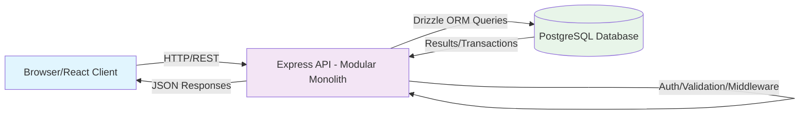
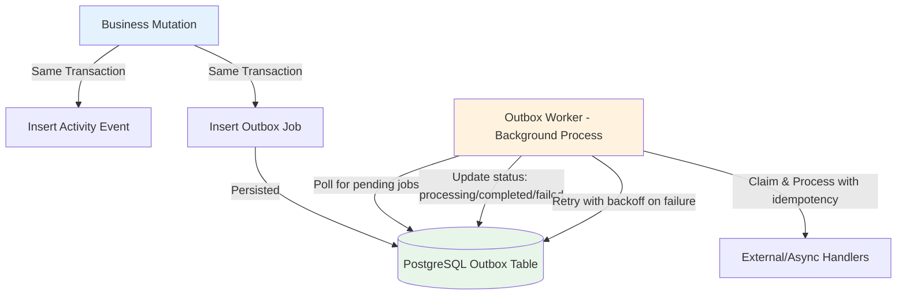
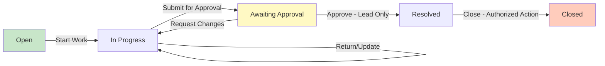

# Architecture - Newtonite Operations Under Pressure

## 1. Overview

Newtonite Operations Under Pressure is an internal operational work-management application designed to replace fragmented coordination through chat, spreadsheets, email, and direct conversations. It enables users to create, assign, track, discuss, approve, resolve, and close operational work across multiple teams.

The application must provide clear visibility into: what work exists and why, current status and priority, current ownership, historical changes and decisions, and what requires attention next.

## 2. Approved Technology Stack

The following stack is authoritative and must be documented exactly as specified:

| Layer | Technology | Notes |
|---|---|---|
| Frontend | React + TypeScript | Client-side user interface |
| Frontend Server-State | TanStack Query | Data fetching, caching, synchronization |
| Backend | Node.js + Express + TypeScript | REST API server |
| Database | PostgreSQL (hosted on Neon) | Source of truth for all business data |
| ORM | Drizzle ORM | Typed schema definitions and queries |
| Migration Tooling | Drizzle Kit | Database schema migrations |
| Testing | Vitest + Supertest | Unit and integration testing |
| Local Development | Docker Compose | Local development environment |

**Important Constraints:**
- **Prisma is prohibited.**
- Architecture is a **modular monolith**.
- PostgreSQL is the source of truth for business data, audit history, idempotency records, and durable background-job intent.

### Database Provider (Neon)

PostgreSQL is hosted on **Neon**. The `DATABASE_URL` environment variable supplies the Neon connection string to both the runtime client and Drizzle Kit.

- **Runtime driver:** `drizzle-orm/neon-serverless` — the Neon WebSocket `Pool` from `@neondatabase/serverless`. Selected because atomic claims, optimistic concurrency, idempotency, and the transactional outbox require **interactive transactions**, which the `neon-http` driver does not support.
- **Migration connection:** Drizzle Kit connects to Neon directly over the standard PostgreSQL wire protocol using the same `DATABASE_URL`.
- **Node.js limitation:** The Neon serverless driver requires a `WebSocket` constructor under Node; the app sets `neonConfig.webSocketConstructor = ws` at startup.

## 3. Architectural Style

### Modular Monolith

The application uses a **modular monolith** architecture with clearly defined module boundaries. This approach:

- Keeps all code in a single deployable unit while maintaining logical separation of concerns
- Enables strong transactional consistency across modules using PostgreSQL transactions
- Prioritizes implementation speed and correctness over distributed deployment complexity
- Supports shared database access without introducing cross-service communication overhead

### Core Modules

The application is logically separated into the following modules:

| Module | Responsibility |
|---|---|
| **Authentication** | User authentication, session/token management for seeded demo users |
| **Authorization** | Team-scoped role-based access control, permission checks |
| **Work Items** | Work item lifecycle, state management, business rules |
| **Workflow** | State machine enforcement, transition validation |
| **Activity History** | Append-only audit trail of all significant changes |
| **Comments** | Collaboration through threaded discussions |
| **Idempotency** | Request deduplication and replay protection |
| **Background Processing** | Transactional outbox worker for asynchronous tasks |

## 4. Data Model

### Users and Teams

Users can belong to multiple teams. Each user-team membership has its own role.

**Roles (team-scoped):** Viewer, Member, Lead, Admin

```mermaid
erDiagram
    users {
        uuid id PK
        string name
        string email UK
        timestamp created_at
        timestamp updated_at
    }
    teams {
        uuid id PK
        string name UK
        string description
        timestamp created_at
        timestamp updated_at
    }
    user_team_memberships {
        uuid id PK
        uuid user_id FK
        uuid team_id FK
        enum role
        timestamp created_at
        timestamp updated_at
        unique(user_id, team_id)
    }
```

**Note:** Seeded demo users are sufficient. User registration is out of scope.

### Work Items

Every work item contains the following fields:

| Field | Type | Constraints | Notes |
|---|---|---|---|
| id | UUID (PostgreSQL) | PK | Use UUID unless existing repository constraint requires architect review |
| title | String | Required | Work item title |
| description | Text | Optional/Required per validation | Detailed description |
| type | Enum | Required | Incident, Customer issue, Payment investigation, Compliance request, Task |
| priority | Enum/String | Required | Priority level |
| status | Enum | Required | Workflow state |
| team_id | UUID | FK, Required | Owning team |
| assignee_id | UUID | FK, Nullable | Assigned user (may be null) |
| created_by | UUID | FK, Required | User who created the item |
| due_at | Timestamp | Nullable | Due date (may be null) |
| version | Integer | Required | Monotonically increasing for optimistic concurrency |
| created_at | Timestamp | Required | Creation timestamp |
| updated_at | Timestamp | Required | Last update timestamp |

```mermaid
erDiagram
    work_items {
        uuid id PK
        string title
        text description
        enum type
        string priority
        enum status
        uuid team_id FK
        uuid assignee_id FK nullable
        uuid created_by FK
        timestamp due_at nullable
        int version
        timestamp created_at
        timestamp updated_at
    }
```

### Activity History (Append-only)

Activity events record all significant changes. Each event includes actor, work item, event type, timestamp, and relevant before/after values.

Minimum tracked changes: status changes, assignee changes, priority changes.

| Field | Type | Constraints | Notes |
|---|---|---|---|
| id | UUID | PK | Event identifier |
| work_item_id | UUID | FK, Required | Related work item |
| actor_id | UUID | FK, Required | User who performed the action |
| event_type | String/Enum | Required | Type of change (status, assignee, priority) |
| before_values | JSONB | Nullable | Values before change |
| after_values | JSONB | Nullable | Values after change |
| metadata | JSONB | Nullable | Additional context |
| created_at | Timestamp | Required | Event timestamp (append-only) |

### Comments

Comments support collaboration on work items.

| Field | Type | Constraints | Notes |
|---|---|---|---|
| id | UUID | PK | Comment identifier |
| work_item_id | UUID | FK, Required | Related work item |
| author_id | UUID | FK, Required | Comment author |
| content | Text | Required | Comment body |
| created_at | Timestamp | Required | Creation timestamp |
| updated_at | Timestamp | Required | Last update timestamp |

### Idempotency Records

Idempotency keys protect retry-sensitive operations.

| Field | Type | Constraints | Notes |
|---|---|---|---|
| id | UUID | PK | Record identifier |
| key | String | UK, Required | Idempotency key |
| request_hash | String | Required | Hash of request body/method to detect key reuse |
| response_status | Integer | Required | Original HTTP status |
| response_body | JSONB | Required | Original response body |
| created_at | Timestamp | Required | Creation timestamp |
| expires_at | Timestamp | Nullable | Optional expiration |

### Outbox Jobs (Transactional Outbox)

For secondary asynchronous work, outbox jobs are inserted in the same transaction as business mutations.

| Field | Type | Constraints | Notes |
|---|---|---|---|
| id | UUID | PK | Job identifier |
| event_type | String | Required | Type of event to process |
| payload | JSONB | Required | Event payload |
| status | Enum | Required | Pending, Processing, Completed, Failed |
| retry_count | Integer | Required, Default 0 | Number of retry attempts |
| max_retries | Integer | Required | Maximum retry attempts (bounded) |
| last_error | Text | Nullable | Last error message |
| next_retry_at | Timestamp | Nullable | Scheduled retry time |
| processed_at | Timestamp | Nullable | Completion timestamp |
| created_at | Timestamp | Required | Creation timestamp |

## 5. Workflow & State Machine

### Approved Initial State Machine

`Open → In Progress → Awaiting Approval → Resolved → Closed`

### Workflow Rules

- **Server enforcement:** The server enforces allowed transitions. Clients must not bypass workflow rules by submitting arbitrary status values.
- **Approval authorization:** Only a Lead authorized for the item's team may perform the approval action (moving to/through approval steps as defined by the transition logic).
- **No reopening:** Reopening Closed items is out of scope.
- **Team-scoped:** All workflow authorization checks are scoped to the item's team.

## 6. Role & Permission Matrix

The matrix below is documented exactly as specified - no additions or removals.

| Action | Viewer | Member | Lead | Admin |
|---|---|---|---|---|
| View permitted team items | Yes | Yes | Yes | Yes |
| Create work items | No | Yes | Yes | Yes |
| Edit permitted item fields | No | Yes | Yes | Yes |
| Claim unassigned work | No | Yes | Yes | Yes |
| Approve workflow step | No | No | Yes | Yes |
| Manage team membership | No | No | No | Yes |

**Key Constraints:**
- All permissions are scoped to the relevant team.
- Backend enforces authentication, team membership, resource access, and action permissions for every protected operation.
- Hiding frontend controls is **not** an authorization mechanism.
- Members cannot approve items or bypass workflow rules.
- Leads can approve and reassign within their team.
- Admin permissions remain team-scoped.

## 7. API Inventory

The following initial endpoints are approved:

| Method | Endpoint | Description | Notes |
|---|---|---|---|
| POST | `/auth/login` | Authenticate seeded demo user | Returns auth token/session |
| GET | `/me` | Get current authenticated user with team memberships | Requires authentication |
| GET | `/items` | List work items with server-side filtering, search, and cursor pagination | Team-scoped results based on membership |
| POST | `/items` | Create new work item | Team-scoped; requires appropriate role |
| GET | `/items/:id` | Get work item details | Requires team access |
| PATCH | `/items/:id` | Edit permitted fields | Enforces permissions, versioning, auth |
| POST | `/items/:id/claim` | Claim unassigned work item | Atomic conditional update; returns 409 if already assigned |
| POST | `/items/:id/transition` | Transition work item state | Enforces workflow rules; Lead-only for approval |
| POST | `/items/:id/comments` | Add comment to work item | Requires team access and appropriate role |
| GET | `/items/:id/activity` | Get activity history for work item | Requires team access |

### HTTP Error Responses

Consistent error handling with appropriate status codes:

| Status | Usage |
|---|---|
| 401 | Unauthenticated requests |
| 403 | Forbidden actions (insufficient permissions) |
| 404 | Resource not found / concealment appropriate |
| 409 | Conflicts (concurrent claim lost, stale version, key reuse) |
| 422/400 | Validation errors for invalid requests |

## 8. Critical Behaviors & Correctness

The following behaviors must be correctly implemented and tested:

| Behavior | Description | Expected Outcome |
|---|---|---|
| **Concurrent claim** | Two concurrent requests claim the same unassigned item | Exactly one succeeds; the other receives 409 Conflict |
| **Stale update** | Update submitted with old version number | Rejected with 409 Conflict; newer data remains intact; version unchanged |
| **Idempotency** | Same request with same idempotency key retried | Produces one logical operation; returns original result |
| **Workflow enforcement** | Invalid transition or unauthorized approval attempted | Request fails with appropriate error (403/422) |
| **Resource authorization** | Access attempt from user not in item's team | Denied (403/404 as appropriate for concealment) |
| **Audit atomicity** | Activity event insert fails in same transaction as mutation | Entire transaction rolls back; work item mutation is not persisted |

**Testing Requirements:**
- Use **real PostgreSQL** for transaction and concurrency integration tests (mock-only tests insufficient)
- Use **Vitest + Supertest**
- All tests must be runnable through a documented command
- Testing occurs throughout implementation; Phase 6 closes critical coverage gaps

## 9. Dashboard Views

Three operational views are required:

1. **Assigned to Me** - Work items currently assigned to the authenticated user
2. **Unassigned Urgent** - Urgent priority work items that are unassigned (team-scoped)
3. **Awaiting My Approval** - Work items awaiting approval where the user is an authorized Lead (team-scoped)

All views must support:
- Server-side search
- Server-side filtering
- Deterministic ordering
- Cursor pagination
- No loading of all records into application memory or browser

## 10. Performance & Indexing Strategy

### Pagination

- Use **cursor pagination** with deterministic ordering (not offset/limit alone where applicable)
- Ensure consistent results across pages

### Indexes (Required Access Patterns)

Indexes must cover the following access patterns:

- Team-scoped status and updated-time queries (for list views and filtering)
- Team-scoped urgent work queries (for "Unassigned Urgent" view)
- Assignee and status queries (for "Assigned to Me" view)
- Work-item activity history ordered by creation time (for activity timeline)
- Composite indexes that match actual query predicates and sort order

### Constraints

- Do not add Redis, dedicated search engine, read replicas, or partitioning in the initial build
- These may be documented as future scaling options only

### Expected Scale

- Thousands of registered users
- Hundreds to a few thousand simultaneous users
- Multiple teams
- Tens of thousands of active work items
- Large and continuously growing activity history

## 11. System Architecture Diagrams

### 11.1 Browser → API → PostgreSQL



### 11.2 Transactional Outbox → Worker



### 11.3 Work-item Workflow



## 12. Testing Approach

- **Framework:** Vitest + Supertest
- **Integration Tests:** Real PostgreSQL for concurrency, transactions, and atomicity
- **Coverage Focus:** Critical correctness behaviors (claim, versioning, idempotency, workflow, auth, audit)
- **Test Commands:** Documented in README.md
- **Phased Testing:** Tests developed throughout implementation, with Phase 6 dedicated to closing critical coverage gaps

## 13. Transaction Boundaries

- **Business mutation + Activity event:** Must commit in the same PostgreSQL transaction
- **Business mutation + Outbox job:** Must commit in the same PostgreSQL transaction (for transactional outbox pattern)
- **Atomic claim:** Conditional UPDATE with WHERE clause (item unassigned AND team matches) to ensure exactly one winner
- **Optimistic concurrency:** UPDATE with version check (version = expected) AND increment version on success
- **Idempotency:** Check existing record by key first; on conflict with different request, reject with appropriate error

## 14. Future Scaling Considerations (Not Initial)

The following are **not** required for initial implementation but may be considered later:
- Redis (caching/session store)
- Dedicated search engine (Elasticsearch/OpenSearch)
- Read replicas
- Database partitioning
- Microservices decomposition
- WebSockets for real-time updates
- SSO, email delivery, file attachments

## 15. Requires Architect Review

There are no known conflicts between this specification and the empty repository state at the time of documentation creation. If any genuine technical conflict is discovered during future implementation that cannot be reconciled without violating the approved specification, it must be documented here with exact details before making conflicting implementation decisions.